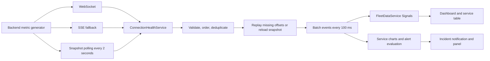

# Fleet Pulse

Fleet Pulse is a service operations dashboard. The Angular frontend gets service data, alert rules, and live metric events from a Node.js backend. The backend saves application data in JSON files.

## Folder structure

```text
Fleet-Pulse/
├── frontend/                 Angular application and browser tests
│   ├── src/app/core/          Shared services, guards, interceptor, config
│   ├── src/app/features/      Login, dashboard, services, alerts, settings
│   ├── src/app/layouts/       Main and login page layouts
│   ├── Dockerfile             Builds the Angular app and serves it with Nginx
│   └── nginx.conf             Sends Angular routes back to index.html
├── backend/                  Express API and Node tests
│   ├── src/config/            Port, secrets, and JSON directory settings
│   ├── src/controllers/       HTTP request handlers
│   ├── src/middleware/        Authentication, permissions, chaos, errors
│   ├── src/routes/            API route definitions
│   ├── src/services/          JSON storage, authentication, metrics, rules, streams
│   ├── src/data/              Local JSON files when run without Docker
│   ├── tests/                 Backend API integration tests
│   └── Dockerfile             Backend container image
├── docker-compose.yml         Starts both containers and stores JSON in a volume
├── README.md
└── .gitignore
```

## Technologies and prerequisites

- Angular 21, standalone components, Signals, RxJS, and strict TypeScript.
- Angular Material is installed. The existing pages keep their styled HTML tables and controls to preserve the current design. Their row lists use Angular `@for` with stable service IDs.
- Chart.js with `ng2-charts` for fleet and service charts.
- Node.js 22+, npm, and Express 5 for the backend.
- Docker Compose v2 is optional.

## Run locally

Install packages once:

```powershell
cd backend
npm.cmd install
cd ..\frontend
npm.cmd install
```

Set a backend secret in `backend/.env` (copy `backend/.env.example` first). Use a long random value for `JWT_SECRET`.

Terminal 1, backend:

```powershell
cd backend
npm.cmd run dev
```

Terminal 2, frontend:

```powershell
cd frontend
npm.cmd start
```

Open `http://localhost:4200`. The backend health endpoint is `http://localhost:4000/health`.

If port 4000 is already in use, use the existing backend process or stop that process before starting another one.

## Docker Compose

From the repository root:

```powershell
docker compose up --build
```

Open `http://localhost:4200`. The API is available at `http://localhost:4000`. The browser uses these host URLs, so the API URL in `frontend/src/environments/` remains `http://localhost:4000`.

Compose saves backend JSON files in the named `fleet-pulse-data` volume. Container recreation therefore keeps rules, refresh-token records, and chaos settings. For a real deployment, set a private `JWT_SECRET` in the environment before running Compose. The example secret in the Compose file is only for local demonstration.

Stop containers with `Ctrl+C`, then run `docker compose down`. To remove saved demo data too, run `docker compose down -v`.

## Demo accounts

Both accounts use password `pulse123`:

| Role | Email | Access |
|---|---|---|
| Viewer | `viewer@pulse.dev` | Dashboard, services, and service details; read-only rules API |
| Operator | `operator@pulse.dev` | Viewer pages, alert-rule management, and settings |

## API endpoints

All errors use `{ "error": { "code": "...", "message": "...", "details": [] } }`.

| Method and path | Access | Purpose |
|---|---|---|
| `GET /health` | Public | Health check |
| `POST /auth/login` | Public | Check email/password; issue access and refresh tokens |
| `POST /auth/refresh` | Public | Rotate a refresh token and issue a new pair |
| `GET /services` | Access token | Return all service records |
| `GET /metrics/snapshot` | Access token | Current metrics and global event offset |
| `GET /metrics/history?serviceId=svc-0412&minutes=15` | Access token | One second historical points, 1–60 minutes |
| `GET /metrics/replay?since=123` | Access token | Events after the supplied global offset |
| `GET /rules` | Viewer or operator | Read all rules |
| `GET /rules/:id` | Viewer or operator | Read one rule |
| `GET /rules/check-name?name=Latency&excludeId=rule-0001` | Viewer or operator | Check rule-name availability |
| `POST /rules` | Operator | Create a rule; send `Idempotency-Key` |
| `PUT /rules/:id` | Operator | Update a rule |
| `DELETE /rules/:id` | Operator | Delete a rule |
| `GET /chaos` | Public | Read chaos settings |
| `POST /chaos` | Public | Merge chaos settings into the current configuration |
| `DELETE /chaos` | Public | Reset chaos settings |
| WebSocket `/stream?access_token=...` | Access token | Primary live metric stream |
| `GET /stream/sse?access_token=...` | Access token | Server-Sent Events fallback |

The polling fallback uses `GET /metrics/snapshot` every two seconds. The polling interval is controlled by the frontend.

## Important backend files

| File | What it does |
|---|---|
| `backend/src/server.js` | Checks JSON files, initializes metric generation, then starts the server. |
| `backend/src/app.js` | Adds JSON parsing, CORS, chaos middleware, API routes, and error handling. |
| `backend/src/config/config.js` | Sets allowed JSON names, data directory, port, and token settings. `DATA_DIRECTORY` can point to a Docker volume. |
| `backend/src/services/jsonFileService.js` | Reads and writes only backend-approved JSON files. Missing files get defaults; existing files are not reset at startup. Updates use queued, atomic writes. |
| `backend/src/utils/initialData.js` | Makes the initial two users, 2,000 services, metric seeds, and default settings. |
| `backend/src/services/authService.js` | Checks bcrypt password hashes, signs JWT access tokens, and rotates refresh tokens. |
| `backend/src/middleware/authenticate.js` | Verifies bearer access tokens for protected APIs. |
| `backend/src/middleware/requireRole.js` | Blocks viewer writes to operator-only features. |
| `backend/src/services/metricsRuntimeService.js` | Generates metric events with a shared offset, per-service sequence, and in-memory five-minute replay buffer. |
| `backend/src/services/streamingService.js` | Shares metric events and heartbeats over WebSocket and SSE, including configured chaos behavior. |
| `backend/src/services/rulesService.js` | Validates, checks, and stores alert rules and idempotent create responses. |
| `backend/src/services/chaosService.js` | Validates and saves global chaos settings and notifies streaming code when they change. |
| `backend/src/middleware/chaosMiddleware.js` | Applies configured delay, HTTP 500, or HTTP 429 behavior to eligible API requests. |

### JSON storage

The JSON files are created only when missing. They hold users, refresh-token hashes, services, metric seed data, rules, idempotency responses, and chaos settings. Passwords are stored as bcrypt hashes. Refresh tokens are stored as SHA-256 hashes. Access tokens are not written to JSON.

High-rate metric events are kept in memory instead of writing every event to disk. The in-memory replay buffer is limited to five minutes; restarting the backend starts a new runtime event history. The latest app records and settings remain in JSON.

## Authentication and refresh

1. The login form sends the email and password to `POST /auth/login`.
2. The backend compares the password with the stored bcrypt hash.
3. On success it returns a short-lived JWT access token and a random refresh token. Angular keeps both in memory Signals; neither goes in local storage.
4. The HTTP interceptor adds `Authorization: Bearer ...` to protected requests.
5. If an API responds with `token_expired`, the interceptor calls `/auth/refresh`. Concurrent expired requests share one refresh call, then each retries its original request.
6. The backend marks the old refresh token record revoked and stores the hash of a replacement token. Reusing the old token returns `401 refresh_invalid`.
7. If refresh fails, Angular clears login state. The main layout observes this and closes its stream, then the interceptor navigates to login with the original URL as `returnUrl`.

Login is memory-only by design. Refreshing the browser clears the session and requires another login.

## Frontend flow

- `app.routes.ts` connects URLs to lazy-loaded standalone pages and protects routes with auth and role guards.
- `MainLayout` provides the sidebar, toolbar, notification area, and nested outlet for the selected page.
- `AuthService` owns in-memory token and user Signals. `auth.interceptor.ts` adds tokens and handles refresh/retry rules.
- `FleetDataService` is the one place components use for REST data. Components do not call backend URLs themselves.
- `ConnectionHealthService` hides WebSocket/SSE/polling details from pages. It batches live events and updates shared service Signals.
- Dashboard displays fleet status totals, average latency, request totals, and charts.
- Services displays searchable, sortable, paginated service data. It restores search/status/sort from URL query parameters and briefly flashes a status cell when a live event changes that service's status. `/rules` is the assignment route for operators; `/alert-rules` remains as a compatible route.
- Service Details loads 15 minutes of history for the selected service and adds its live events. Changing service clears the previous data first.
- Alert Rules uses a Reactive Form and FormArray for rule conditions. Metric selection changes the threshold label and error-rate limit. The rule-name check is an async validator; saving stays disabled while it is pending. Create sends an idempotency key. Rules are persisted by the backend; incidents are session-only frontend records derived from live events.

### Stream pipeline


- Settings uses a template-driven form. It saves the event rate to `/chaos`; chart refresh and notification preferences stay in browser memory.

## Live transport and data integrity

Transport order is WebSocket, then SSE, then polling. WebSocket attempts have a five-second connection timeout and switch to SSE after three failures. SSE switches to polling after three failures. Polling reads a snapshot every two seconds. While using SSE or polling, the service probes WebSocket every 30 seconds; reconnect delays use randomized exponential backoff with a 250 ms floor and 30-second maximum. The browser does not reconnect while offline and retries immediately after its `online` event.

WebSocket and SSE heartbeats arrive every five seconds. The client closes a live stream after two missed heartbeats. Metric events carry a global offset and a per-service sequence. The client buffers out-of-order offsets for up to one second, requests replay after a gap, counts duplicate and malformed events, and reloads a snapshot if replay is too old or cannot fill the gap.

Live data is batched for component consumers every 100 milliseconds. The service table keeps at most 50 visible rows (`@for` tracks by service ID), even though it filters and sorts the full 2,000-service list. Live table recomputation is limited to once per 300 milliseconds. Service chart history is reduced to 300 evenly spaced points while preserving the first and last point; live chart updates keep the newest 300 points. Chart data preparation is guarded per chart panel and each panel has a Retry control.

## Chaos switch examples

Use PowerShell from another terminal. Chaos endpoints are public in this demo.

```powershell
Invoke-RestMethod -Method Post -Uri http://localhost:4000/chaos `
  -ContentType 'application/json' -Body '{"ws":"down"}'

Invoke-RestMethod -Method Post -Uri http://localhost:4000/chaos `
  -ContentType 'application/json' -Body '{"ws":"down","sse":"down"}'

Invoke-RestMethod -Method Post -Uri http://localhost:4000/chaos `
  -ContentType 'application/json' -Body '{"ws":"silent"}'

Invoke-RestMethod -Method Post -Uri http://localhost:4000/chaos `
  -ContentType 'application/json' -Body '{"chaos":"shuffle,dupe"}'

Invoke-RestMethod -Method Post -Uri http://localhost:4000/chaos `
  -ContentType 'application/json' -Body '{"ws":"drop:20"}'

Invoke-RestMethod -Method Post -Uri http://localhost:4000/chaos `
  -ContentType 'application/json' -Body '{"token_ttl":5}'

Invoke-RestMethod -Method Post -Uri http://localhost:4000/chaos `
  -ContentType 'application/json' -Body '{"http":"500:50"}'

Invoke-RestMethod -Method Post -Uri http://localhost:4000/chaos `
  -ContentType 'application/json' -Body '{"chaos":"garbage:5"}'

Invoke-RestMethod -Method Delete -Uri http://localhost:4000/chaos
```

The last command resets switches to defaults. Browser offline is tested from the browser’s developer tools by switching its Network panel to Offline, then back to Online.

## Resilience decisions R1–R4

These labels summarize the project’s implementation choices:

- **R1 — Transport fallback:** WebSocket first, SSE second, snapshot polling last; timeout/failure thresholds and 30-second probes are described above.
- **R2 — Event recovery:** global offsets, per-service sequence checks, bounded out-of-order buffering, replay, and snapshot recovery prevent a gap from being silently ignored.
- **R3 — Bounded rendering:** live updates are batched, chart series stay at 300 points, and service table DOM is limited by pagination to 50 rows.
- **R4 — Request and session safety:** short-lived access JWTs, rotating hashed refresh tokens, role checks on both UI and API, and limited GET/idempotent POST retry rules.

For a production system, R1 would use a managed stream gateway and shared connection metrics; R2 would use durable event storage and server-side replay checkpoints; R3 would add measured virtualization and profiling at the target event rate; R4 would use a managed identity provider, secure cookie-based refresh handling, and centralized API rate limits. These are intentionally outside this local demonstration.

## Tests and measured results

Run frontend unit tests:

```powershell
cd frontend
npm.cmd test -- --watch=false
```

Run the frontend production build:

```powershell
cd frontend
npm.cmd run build
```

Run backend API integration tests using temporary JSON files:

```powershell
cd backend
npm.cmd test
```

**Measurements actually made in this development environment:** the Angular production build completed successfully; 30 frontend unit tests passed; 7 backend API integration tests passed. Backend API tests confirmed responses containing 2,000 services, 2,000 snapshot metrics, and 900 history points. Five sequential local `Invoke-RestMethod` calls per endpoint measured `/services` median 29.86 ms (range 22.80–50.97 ms), and `/metrics/snapshot` median 70.69 ms (range 61.57–75.51 ms). These include PowerShell client overhead and are only a local spot check, not a throughput benchmark. The build output reported an estimated initial transfer size of about 92.4 kB (323.59 kB raw); chart and alert-rule code is in lazy chunks. This is a build estimate, not a separate gzip or browser-network measurement. Compose syntax validation passed, but image build and container startup were not verified because the Docker engine pipe was unavailable.

The assignment's Chrome measurements at 4× CPU throttling have **not** been run. No frame-rate/long-task, input-latency, or 5-to-30-minute heap result is available. The service-list unit test confirms 25 rows by default and 50 at the largest page-size option; it is not a DevTools count under a live 2,000-events/sec stream. The requested full-rate browser benchmark and Angular DevTools render profile remain unverified.

## Known limitations

- The metrics are generated demo values, not production telemetry.
- Runtime metric history and replay are in memory and reset when the backend restarts.
- Alert rules persist in JSON. Incidents and display preferences are held in frontend memory.
- The local Compose JWT secret is a demonstration default; configure a private secret for any shared environment.
- Unit/API tests cover refresh rotation, permission checks, rule idempotency, metrics, transport recovery logic, retry classification, validators, chart reduction, and selected chaos behavior. The full interactive browser failure-drill list (including the browser Offline control and every random chaos combination) has not been run end to end.
- Docker Compose configuration parsed successfully. `docker compose build` could not connect because the Docker daemon was not running at `npipe:////./pipe/docker_engine`; run the documented command once Docker Desktop is running.
- Chart data preparation errors are displayed and retried per panel. A low-level exception thrown internally by the chart library itself is not currently captured by a dedicated Angular chart error boundary.
- Angular Material is installed, but native styled tables were kept to avoid changing the existing interface. Pagination and stable row tracking are used for the current 2,000-row service dataset.
- ESLint/angular-eslint and Prettier are not configured yet; there is no verified lint result.

## AI usage disclosure

AI assistance was used to review the project requirements, make code changes, and draft this documentation. The changes were checked with the listed build and automated tests. Review the code and test results before submitting or deploying the project.
