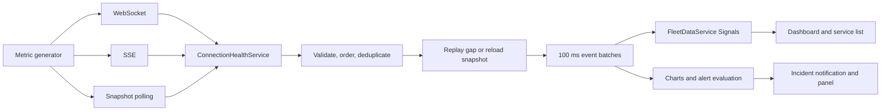

# Fleet Pulse

Fleet Pulse is a real-time service operations dashboard built for the Frontend Developer Take-Home Assignment. The Angular 21 frontend consumes a Node.js/Express mock API and live metric stream. The mock backend generates 2,000 services and supports the assignment's HTTP, WebSocket, SSE, and chaos behaviors.

## Setup

### Requirements

- Node.js 22 or newer and npm.


### Run locally

Create `backend/.env` with a private development secret before starting the API:

```text
JWT_SECRET=replace-with-a-long-random-secret
```

In terminal 1, install and start the backend:

```powershell
cd backend
npm ci
npm start
```

In terminal 2, install and start the frontend:

```powershell
cd frontend
npm ci
npm start
```

Open `http://localhost:4200`. The API listens on `http://localhost:4000`; health check: `http://localhost:4000/health`.

The backend requires `JWT_SECRET`. Optional settings are `PORT` (default `4000`), `FRONTEND_ORIGIN` (default `http://localhost:4200`), `ACCESS_TOKEN_TTL` (default `60` seconds), `REFRESH_TOKEN_TTL_SECONDS` (default `604800` seconds), and `DATA_DIRECTORY` (defaults to `backend/src/data`).

### Run with Docker Compose

From the repository root:

```powershell
docker compose up --build
```

The frontend is at `http://localhost:4200`, the API at `http://localhost:4000`. Compose uses a named volume for backend JSON data. Its built-in JWT secret is for local demonstration only; set `JWT_SECRET` in the environment before using Compose outside a local demo. Stop with `Ctrl+C`; `docker compose down -v` also removes the saved data volume.

### Demo accounts

Both accounts use password `pulse123`:

| Role | Email | Access |
|---|---|---|
| Viewer | `viewer@pulse.dev` | Dashboard, services, service details, and read-only rules |
| Operator | `operator@pulse.dev` | Viewer access plus rule and settings management |

## Architecture

The frontend is organized into standalone, lazy-loaded Angular pages, shared layouts, and core services. Components use `FleetDataService` for REST data and `ConnectionHealthService` for live metric batches; they do not open transports themselves. `AuthService`, route guards, and the HTTP interceptor handle identity, roles, bearer tokens, refresh, request timeouts, and retries.



## Resilience decisions

### R1 — Transport fallback

The client tries WebSocket, then SSE, then `/metrics/snapshot` polling every 2 seconds. A WebSocket attempt times out after 5 seconds; three consecutive failures move to the next transport. While on a lower transport, it probes WebSocket every 30 seconds. Reconnect delays use jittered exponential backoff, with a 250 ms floor and 30 second cap. The client stops reconnecting while the browser is offline and retries when it returns online. Five-second server heartbeats allow the client to mark a stream dead after two missed pings.

### R2 — Event recovery

Each metric event has a global `offset` and per-service `seq`. The client validates event shape, ignores duplicates, buffers out-of-order offsets for up to one second, and asks `/metrics/replay?since=<offset>` to fill gaps. If replay cannot recover the offset, it reloads a snapshot. Malformed event and duplicate counters are available in `ConnectionHealthService` for diagnostics.

### R3 — HTTP resilience

`frontend/src/app/core/config/http-resilience.config.ts` sets a 10 second timeout per attempt, at most 3 attempts, and a 300 ms default retry delay. GET requests retry on network errors, timeouts, 429, 502, 503, and 504. A POST retries only when it has an `Idempotency-Key`; rule creation sends one. Other 4xx responses and HTTP 500 are not retried. A 429 response's `Retry-After` header is honored. The timeout applies to each attempt, so total elapsed time can exceed 10 seconds when retries or `Retry-After` delays occur.

### R4 — UI degradation

The connection indicator reports Live, Polling, Reconnecting, Offline, or Stale state and shows the last event time. Chart data preparation errors are shown per panel with a Retry action. API loading errors are surfaced on the relevant pages. A dedicated error boundary for exceptions thrown internally by the chart library is not implemented.

For production, replace the in-memory stream replay store with durable/shared infrastructure, move refresh-token handling to secure HttpOnly cookies, measure the current table windowing under the target browser workload, and add centralized telemetry.

## Performance

The assignment requires measurement in Chrome at 4× CPU throttling with 2,000 services and a stream rate of 2,000 events per second. In this app, set the rate from **Settings** and save, or send `POST /chaos` with `{"rate":2000}`; the frontend does not read `rate` from the page URL. Results and methods are recorded below. Missing measurements are not inferred from unit tests.

| Target | Result currently recorded | Measurement method | Status |
|---|---|---|---|
| More than 50 fps and no long task over 50 ms during a burst | No result recorded | Set the backend rate to 2,000 events/second, enable 4× CPU throttling in Chrome DevTools Performance, record while using the table, then report frame rate and longest task. | Not measured |
| Search and sort input latency below 100 ms during a burst | No result recorded | Under the same 4× CPU and 2,000 events/second setup, type in search and change sorting during a Performance recording; report input-to-update latency. | Not measured |
| Fewer than 60 table `<tr>` elements at all times | Fixed-height windowing keeps the full filtered result in one scrollable table and renders at most 50 service rows plus up to 2 spacer rows. The updated unit test asserts the rendered count, but has not been run after the change. | During the burst, inspect the table in Elements or run `document.querySelectorAll('tbody tr').length` repeatedly while scrolling. | Implementation in place; test and live count pending |
| Heap growth below 20% from minute 5 to minute 30 | No result recorded | With the 2,000 events/second burst running, take Chrome Memory heap snapshots at minutes 5 and 30 and compare retained heap. | Not measured |
| Initial JavaScript below 350 kB gzipped | A previous build reported 92.4 kB estimated initial transfer (323.59 kB raw). This was not a separate gzip measurement and predates later changes. | Run `npm run build`, record Angular's initial bundle output, and verify gzip size independently before claiming the target. | Estimate only; remeasure required |
| No rendering work for data a component does not show | No profile recorded | Use Angular DevTools Profiler during the 4× CPU, 2,000 events/second run and inspect component change detection/render activity. | Not measured |

Implementation choices include batching live metric notifications every 100 ms, windowing the continuous service table to at most 50 service rows at a time, limiting service charts to 300 points, and throttling service-list recomputation to 300 ms. These choices do not replace the missing browser measurements above.

## Mock backend

The mock uses Node.js 22, Express 5, and JSON files on port 4000. It implements the assignment's required authentication, service, snapshot, history, replay, rule, chaos, health, WebSocket, and SSE API routes. It generates 2,000 services, supports event rates from 1 to 5,000 per second, and retains stream replay events in memory for up to five minutes. JSON files hold users, refresh-token hashes, services, rules, idempotency records, and chaos settings. Passwords are bcrypt-hashed; refresh tokens are SHA-256-hashed.

**Contract additions:** the backend also exposes `GET /metrics` as a legacy metrics endpoint and supports `PUT /rules` and `DELETE /rules` aliases in addition to the contract's ID-based routes. These additions do not replace the required routes.


Chaos endpoints are public in this demo. Use PowerShell to set a global switch:

```powershell
Invoke-RestMethod -Method Post -Uri http://localhost:4000/chaos `
  -ContentType 'application/json' -Body '{"ws":"down","sse":"down"}'
```

Supported switches include `rate` (1–5000), `ws=down|silent|drop:<percent>`, `sse=down`, `chaos=shuffle,dupe,garbage:<percent>`, `token_ttl=<seconds>`, `http=500:<percent>|slow:<milliseconds>|429`, and `kill=<seconds>`. Modes can be combined where supported. Reset all switches with:

```powershell
Invoke-RestMethod -Method Delete -Uri http://localhost:4000/chaos
```

Runtime metric history and replay are in memory and reset when the backend restarts. Historical points not present in the runtime window are generated from the service's current seed values.

## Tests and quality checks

Run frontend unit tests and the production build:

```powershell
cd frontend
npm test -- --watch=false
npm run build
```

Run backend API tests:

```powershell
cd backend
npm test
```

The existing test suites cover transport fallback and event handling, parallel token refresh, retry classification, validators, chart point reduction, rule evaluation, and backend API behavior. The last recorded run before the virtual-scroll change reported 30 frontend tests and 7 backend tests passing. The service-list test has since been updated for windowing but has not been rerun. ESLint/angular-eslint and Prettier are not configured, so there is no `ng lint` result. The full interactive browser failure drills and performance measurements listed above have not all been run.

## Trade-offs and known gaps

- The access token remains in memory. The rotating refresh token is saved in browser `localStorage` so the app can restore a session after reload; a production deployment should use a secure HttpOnly cookie.
- The service table contains the full filtered and sorted dataset in one continuous scroll range; only a small window of rows is mounted in the DOM at a time.
- Chart data preparation failures are isolated per panel, but errors thrown by the chart library itself are not caught by a dedicated boundary.
- Browser performance targets, complete failure drills, and Angular DevTools profiling remain unverified.
- Incidents and display preferences are session/browser state; alert rules and backend configuration are persisted as JSON.
- The mock uses in-memory event generation/replay and local JSON persistence; it is for the assignment demo, not production telemetry.

